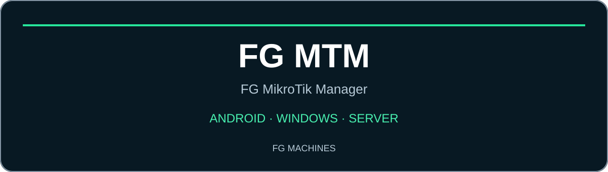
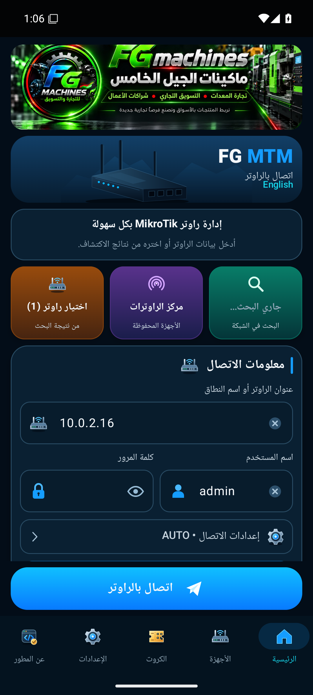
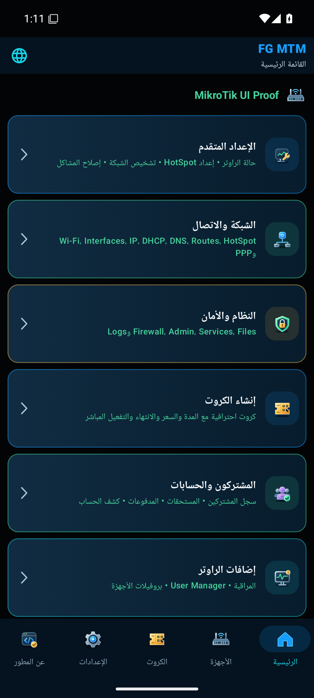
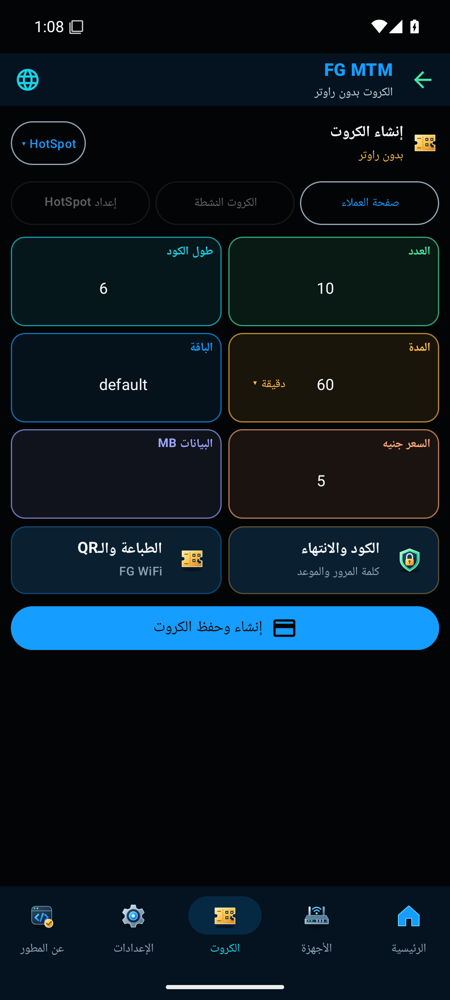
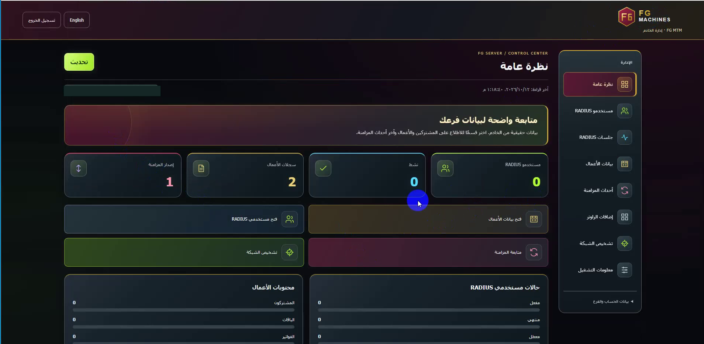

**MikroTik · HotSpot · User Manager · PPPoE**

إدارة الراوتر والكروت والمشتركين والأعمال — بهوية FG Machines.

[تحميل أندرويد 0.20.11](https://github.com/FGMachines/FG-MTM/releases/download/android-v0.20.11/FG-MTM-Android-0.20.11.apk) • [تحميل Windows 0.19.1](https://github.com/FGMachines/FG-MTM/releases/download/v0.19.1/FG-MTM-Windows-0.19.1-Setup.exe) • [كتاب الاستخدام المصوّر](docs/FG-MTM-User-Book-AR.pdf)

# FG MTM — FG MikroTik Manager

**خلّي إدارة شبكتك في إيدك.** من موبايلك أو الكمبيوتر، اتصل براوتر MikroTik، جهّز الكروت، وراجع المشتركين وشغلك اليومي من مساحات واضحة.

## نسخة أندرويد — شبكتك معاك في كل مكان

تطبيق **FG MTM على Android** بيجمع أدوات إدارة الراوتر والكروت وبيانات الأعمال في واجهة عربية. تبدأ بالاتصال والفحص، وبعدها تفتح المساحة اللي محتاجها؛ من غير ما تتنقل بين أدوات منفصلة لكل مهمة.

| الاتصال بالراوتر | الرئيسية | إنشاء الكروت |
| :---: | :---: | :---: |
|  |  |  |

### هتستفيد بإيه؟

| الميزة | بتساعدك في إيه؟ |
| --- | --- |
| الاتصال والاكتشاف | اختيار الراوتر أو إدخال عنوانه وبيانات الدخول |
| مركز الراوترات | حفظ بروفايل لكل جهاز أو فرع والتنقّل بينهم |
| فحص الجاهزية والتشخيص | مراجعة حالة الخدمات وفهم سبب المشكلة قبل تغيير الإعدادات |
| إعداد HotSpot وصفحة العملاء | تجهيز دخول العملاء وتخصيص التصميم، ثم مراجعة نتيجة التثبيت |
| الكروت | إعداد كروت HotSpot وUser Manager وPPPoE حسب نظام شبكتك |
| الطباعة وQR والمشاركة | تجهيز بيانات الكارت وتصميمه ومشاركته حسب الخيارات المتاحة |
| المشتركون والأعمال | متابعة الباقات والفواتير والمدفوعات والمستحقات |
| أدوات الإدارة | الوصول لمساحات الشبكة والأمان والمراقبة وTerminal |

**ابدأ في خمس خطوات:** ثبّت التطبيق ← اتصل بالراوتر ← افحص الجاهزية ← جرّب كارتًا واحدًا ← راجع نتيجة الدخول قبل إصدار دفعة.

[شرح أندرويد خطوة بخطوة](docs/USER-GUIDE-AR.md#android) · [تحميل APK مباشرة](https://github.com/FGMachines/FG-MTM/releases/download/android-v0.20.11/FG-MTM-Android-0.20.11.apk) · [بصمة SHA256](https://github.com/FGMachines/FG-MTM/releases/download/android-v0.20.11/SHA256SUMS.txt)

## تحميل Windows 0.19.1

[تحميل المثبت مباشرة](https://github.com/FGMachines/FG-MTM/releases/download/v0.19.1/FG-MTM-Windows-0.19.1-Setup.exe) · [بصمة التحقق SHA256](https://github.com/FGMachines/FG-MTM/releases/download/v0.19.1/SHA256SUMS.txt)

في التثبيت الجديد، حقول اتصال الخادم تبدأ فارغة؛ كل مستخدم يدخل بيانات حسابه. قبل تحديث نسخة موجودة، خد نسخة احتياطية وراجع إعداداتك بعد التحديث.

## الكتاب المصوّر

[تحميل كتاب الاستخدام العربي الملون — 43 صفحة](docs/FG-MTM-User-Book-AR.pdf)

شرح Android 0.20.4 وWindows 0.19.1 ولوحة الخادم، بصور الاستخدام وأمثلة للكروت وحل المشكلات. بتصميم جديد للغلاف، وترويسات لكل قسم، وترقيم واضح، وفهرس قابل للضغط وزر للعودة إليه. الشرح بالعربية والمصري، وروابط التواصل داخل الكتاب قابلة للفتح.

## ابدأ من هنا

- [دليل Android خطوة بخطوة](docs/USER-GUIDE-AR.md#android)
- [دليل Windows خطوة بخطوة](docs/USER-GUIDE-AR.md#windows)
- [شرح لوحة الخادم](docs/USER-GUIDE-AR.md#server)
- [أسئلة شائعة وحل المشكلات](docs/USER-GUIDE-AR.md#faq)

<table>
<tr>
<td width="50%" align="center"></td>
<td width="50%" align="center"></td>
</tr>
</table>

## ما الذي يقدّمه البرنامج؟

| مساحة العمل | الاستخدام |
| --- | --- |
| الراوتر والشبكة | الاتصال بـ MikroTik، التشخيص، وإعداد HotSpot |
| صفحة الدخول | تخصيص اسم الشبكة والترحيب والألوان والشعار وبيانات الدعم |
| الكروت والمشتركون | مساحات لإدارة الكروت والمشتركين والحسابات |
| الأعمال المحلية | متابعة المشتركين والباقات والمستحقات والفواتير، والتصدير والنسخ الاحتياطي |
| الاتصال بالخادم | ربط بيانات الأعمال بحساب المؤسسة والفرع عبر HTTPS |
| لوحة الخادم | نظرة عامة، RADIUS، أحداث المزامنة، بروفيلات الراوتر وتشخيص الخادم |

## تثبيت الخادم على Ubuntu

[**افتح أوامر النشر والتثبيت خطوة بخطوة**](docs/UBUNTU-SERVER-INSTALL-AR.md)

[النسخ الاحتياطي وإنشاء حساب المؤسسة والفرع وإعادة تعيين كلمة المرور](docs/UBUNTU-SERVER-INSTALL-AR.md#server-recovery)

الدليل فيه تثبيت Docker، تنزيل ملفات الخادم، إعداد HTTPS وإنشاء حساب المؤسسة والفرع، وفحص التشغيل والنسخ الاحتياطي والتحديث. اختار مسار السيرفر الجديد أو مسار Nginx للخادم اللي عليه خدمات بالفعل. مصدر الخادم العام موضح داخل الدليل.

## Windows والخادم: ما الفرق؟

| Windows | لوحة الخادم |
| --- | --- |
| يتصل بالراوتر الذي يستطيع جهازك الوصول إليه | تفتحها من المتصفح بعد إعداد الخادم |
| يضم إعداد الشبكة وصفحة الدخول والأعمال المحلية | تعرض بيانات الحساب والفرع والمزامنة |
| يمكن استخدام وظائف محلية دون ربط خادم | تحتاج حسابًا أنشأه مشغّل الخادم |

## الإصدار والبيانات

نسخة Windows الظاهرة في التسجيل هي **0.19.1**. حقول عنوان الخادم والمؤسسة والفرع تبدأ فارغة؛ أدخل بيانات حسابك أنت. حساب الراوتر يختلف عن حساب الخادم وعن حساب المالك المحلي.

الجداول الفاضية والأرقام في الصور تخص وقت التصوير. فتح شاشة أو ظهور زر مش دليل إن العملية نجحت على الراوتر؛ اقرأ النتيجة وجرب الوظيفة بعد التنفيذ.

**المحتوى المتاح هنا:** APK Android موقّع، ومثبت Windows، وكتاب استخدام عربي ملون من 43 صفحة، ودليل Windows والخادم، ولقطات مستقلة لأندرويد وWindows والخادم. صور الكتاب من النسخة 0.20.4. التسجيلات الأصلية غير مرفوعة.

[FG Machines](https://fgmachines.org) · [فتح دليل الاستخدام الكامل](docs/USER-GUIDE-AR.md)

## التواصل مع FG Machines

- [الموقع الرسمي — fgmachines.org](https://fgmachines.org) — الموقع قيد الإنشاء.
- [الحساب الشخصي على Facebook](https://www.facebook.com/share/1EKVAyZZ2C/).
- [صفحة FG Machines التجارية](https://www.facebook.com/share/1T7r3WpH8Y/).
- [جروب Facebook — المناقشات والدعم](https://www.facebook.com/share/g/1Eo3dADWFs/).

