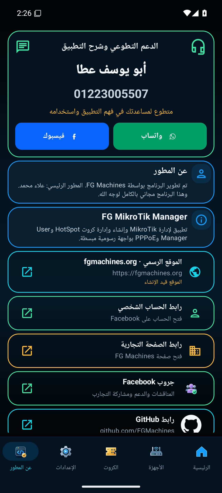

# FG MTM Android 0.20.10

[تحميل APK مباشرة](https://github.com/FGMachines/FG-MTM/releases/download/android-v0.20.10/FG-MTM-Android-0.20.10.apk)

## إيه اللي اتغيّر؟

- حذف بطاقة العنوان الأولى اللي كانت فيها «عن المطور» والبسملة.
- عنوان بطاقة بيانات المطور أصبح «عن المطور».
- تكبير بطاقة «الدعم التطوعي وشرح التطبيق» ونقلها لأول الصفحة.
- أبو يوسف عطا — 01223005507 — متطوع للمساعدة في فهم التطبيق واستخدامه.
- زران متساويان جنب بعض: واتساب بالأخضر وفيسبوك بالأزرق.
- واتساب يفتح المحادثة على الرقم مباشرة، مع محاولة فتح WhatsApp ثم WhatsApp Business، ثم رابط المحادثة لو التطبيقين مش مثبتين.
- فيسبوك يفتح الرابط المحدد: https://www.facebook.com/share/1FbU5L2dvf/

## لقطة فعلية من التطبيق

## التثبيت والتحقق

ثبّت فوق النسخة الحالية دون حذف التطبيق. تم اختبار تحديث 0.20.9 إلى 0.20.10 على محاكي Android 15 مع بقاء بروفايل الراوتر المحفوظ.

- 169 اختبار وحدة ناجحًا.
- 4 اختبارات لصفحة الدعم ناجحة. الفحص الأوسع: 13/14 ناجح، وتعثر اختبار NavigationBackTest لنافذة Terminal بمهلة انتظار 5 ثوانٍ في المحاكي. هذا الاختبار لا يخص صفحة الدعم؛ تم حفظ تفاصيل التعثر في تقرير التحقق.
- Lint: صفر أخطاء، و19 تحذيرًا موجودًا في المشروع.
- التحقق من ترتيب البطاقة وحذف العنوان القديم، وروابط واتساب وفيسبوك، والعربية والإنجليزية.
- التحقق من إنشاء الكروت دون راوتر، وحوارات الانتهاء والطباعة، وموضع قطع الاتصال في الإعدادات.
- التوقيع الأصلي، وحماية R8 وتقليص الموارد، واسم التطبيق FG MTM.
- لم تُرسل رسائل ولم تُجرَ مكالمات، ولم يُختبر هاتف أو راوتر فعلي.

الحجم: 4,026,561 بايت.

SHA256:

`5d7264e242a63791d7f1543dd85f204ff3c1ad7b6c16a8f02863f8c624d5edb1`

مصدر APK: `d266c73132b60ce2a6e0f1b9bae905374acc1683`. التغيير اللاحق يحدّث اختبار الانحدار فقط دون تعديل كود التطبيق.
