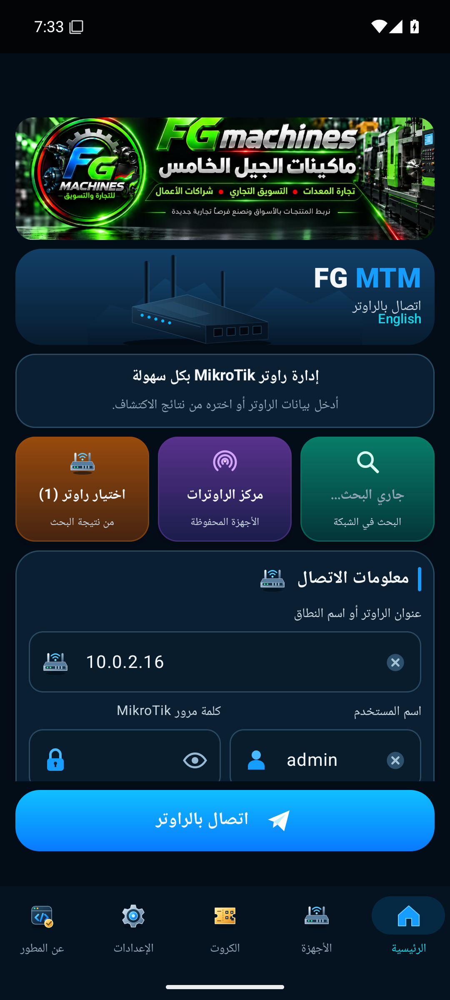
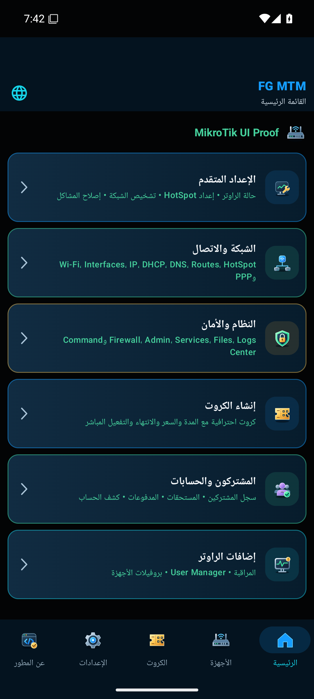
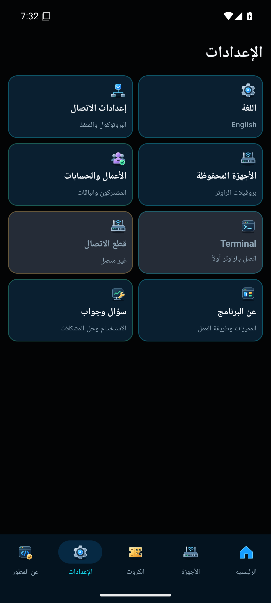
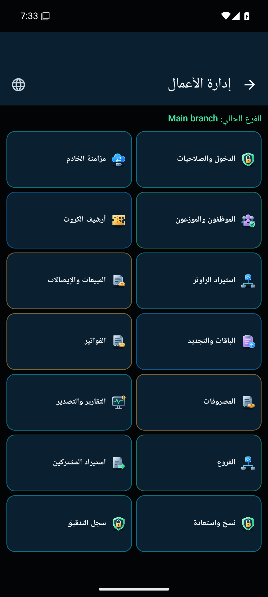

# FG MTM Android 0.20.6

النسخة دي بتعيد تحسينات التصميم والتنسيق الموجودة في نسخة **0.20.4 المعتمدة** إلى مصدر النسخة المحمية **0.20.5**، مع استمرار وظائف التطبيق وحماية الكود.

- بطاقات الرئيسية بتتوزع حسب ارتفاع الشاشة، بنفس الخلفيات المتدرجة والأيقونات الملونة والوصف الأخضر.
- الإعدادات في عمودين، مع توضيح حالة الاتصال والأزرار غير المتاحة.
- مركز الأعمال في شبكة واضحة: عمودين على الهاتف وثلاثة على الشاشات الواسعة، بألوان وأيقونات كل وظيفة.
- اسم المستخدم وكلمة المرور جنب بعض، وبيظهروا تحت بعض عند ضيق الشاشة أو تكبير الخط.
- صورة FG Machines وتنسيق شريط التنقل بنفس اتجاه النسخة المرجعية.
- العربية من اليمين لليسار، والإنجليزية من اليسار لليمين. البطاقات تسمح بزيادة ارتفاعها لتفادي قص الكلام عند تكبير الخط.

## الحماية والتحديث

R8 وتقليص الموارد وتعطيل Debug مستمرة. فحص البناء أكد إعادة تسمية **835 كلاسًا** من التطبيق. شهادة التوقيع الأصلية وهوية التطبيق `com.fgmachines.mikrotikmanager.preview` لم يتغيرا. رقم البناء 36، والإصدار `0.20.6-review`. قد يظهر اسم التطبيق في قائمة الهاتف باسم FG MTM Review.

**ثبّت الملف فوق النسخة الحالية، من غير حذف التطبيق.** اختلاف هوية أو توقيع نسخة أخرى قد يمنع التحديث فوقها.

[تحميل FG-MTM-Android-0.20.6.apk](https://github.com/FGMachines/FG-MTM/releases/download/android-v0.20.6/FG-MTM-Android-0.20.6.apk)

## التحقق

نجح **159 اختبار وحدة** دون فشل، وLint بلا أخطاء. تم التحقق من التوقيع الأصلي وتعطيل Debug. اجتاز التحديث من 0.20.5 على Android 15 مع بقاء بروفايل جهاز تجريبي، وفحص ترتيب حقول الاتصال وشبكة الإعدادات والأعمال، والتنقل بالعربية والإنجليزية، والشاشة الصغيرة مع تكبير الخط. الفحوص جُمعت من تشغيلين لنفس APK؛ تفاصيل مصادرها في تقرير التحقق.

اختبار واجهة الراوتر استخدم محاكاة RouterOS API محلية للقراءة فقط. لم تتم تجربة هذا الإصدار على جهاز MikroTik فعلي، ولا اختبار تنفيذ تغييرات على شبكة حقيقية.

[تقرير التحقق](../distribution/android-0.20.6/verification.json)

SHA256: `36a3dd19f3184415086fde0e62e5ddd877cd5aee829749594555b88f46a77122`.

## صور التشغيل

