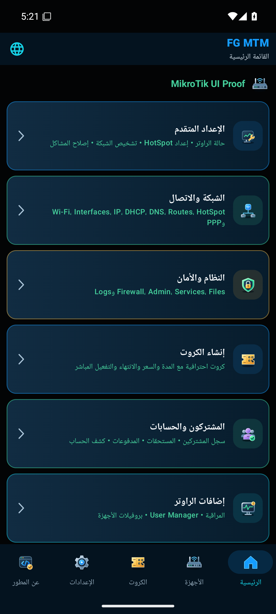
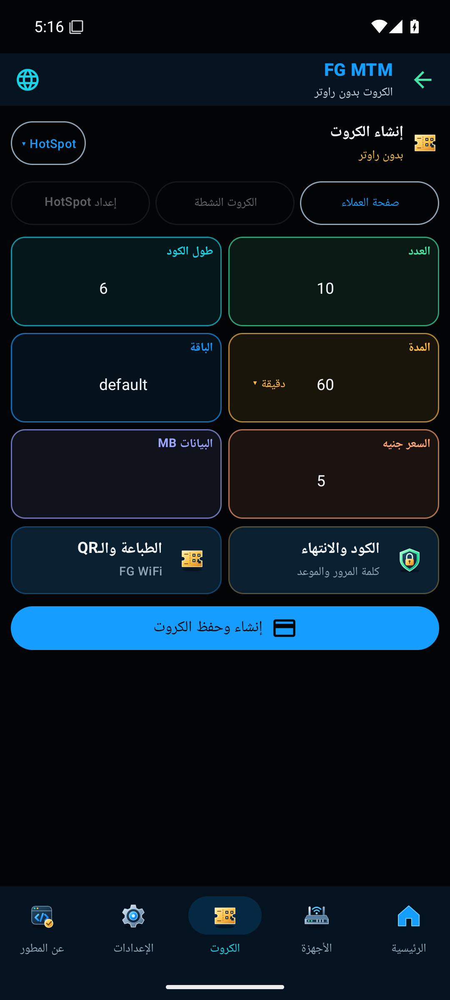
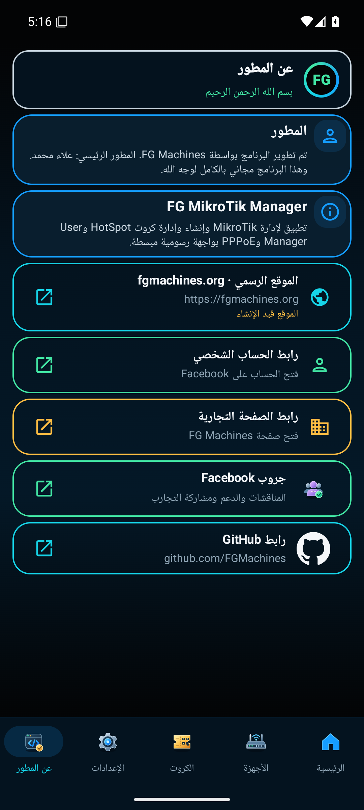
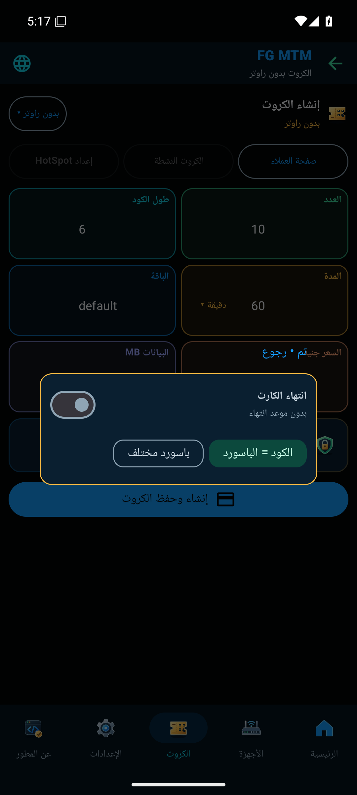
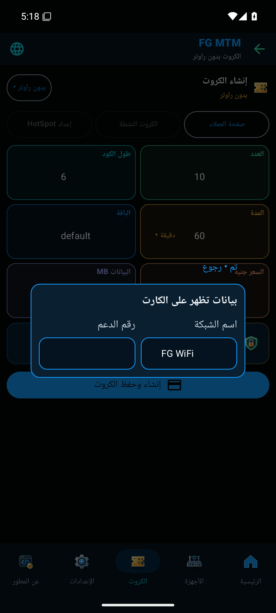
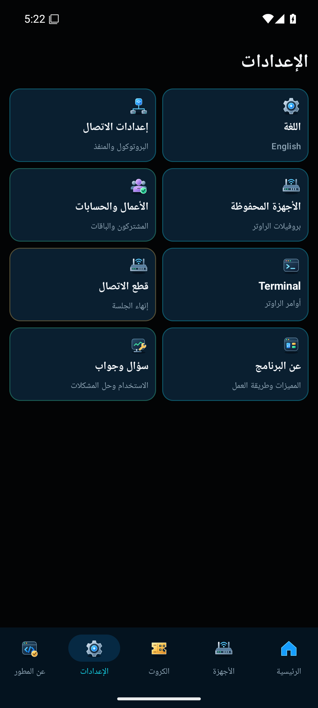

# Android 0.20.7 — تصحيح واجهة FG MTM

هذا الإصدار يصحّح تراجعًا في 0.20.6 عن تحسينات نسخة 0.20.4 المرفقة، ويحتفظ بحماية الكود والتوقيع الأصلي.

## التغييرات المستعادة

| الشاشة | التصحيح |
| --- | --- |
| الرئيسية والإعدادات | بطاقة قطع الاتصال داخل الإعدادات فقط، وإزالة زرها من الرئيسية وقائمة العرض الكبير |
| إنشاء الكروت | عنوان صغير، اختيار النوع من قائمة، ست بطاقات ملونة في ثلاثة صفوف، اختيار المدة والباقات داخل البطاقات |
| خيارات الكروت | بطاقتان بأيقونات للانتهاء والطباعة؛ نوافذ مستقلة بإطارات ملونة، وخيار كلمة مرور مختلفة |
| عن المطور | رابط GitHub لحساب FGMachines، جروب Facebook، وملاحظة أن الموقع قيد الإنشاء |
| المشتركون | إحصاءات الصفحة الحالية وعدد المشتركين، وبطاقة فتح إدارة الأعمال |
| User Manager | إحصاءات الحسابات والباقات والجلسات، مع عرض «—» عند تعذر القراءة |
| مركز الأعمال | عنوان مركز الأعمال واسم الفرع، مع استمرار الشبكة المتكيفة مع العرض |
| عن البرنامج | خمسة أقسام شرح بأيقوناتها وإطاراتها، والعودة إلى الإعدادات |
| إضافات الراوتر | بطاقة داخلية للعودة للرئيسية، مع شرح أدوات الإدارة |

بطاقات إدخال الكروت تبدأ من ارتفاع 82dp كما في المرجع، وتتمدد إذا احتاج الخط الكبير إلى مساحة إضافية.

## صور التشغيل الفعلية

| الرئيسية | الكروت | روابط المطور |
| :---: | :---: | :---: |
|  |  |  |

| الانتهاء وكلمة المرور | الطباعة والـQR | الإعدادات |
| :---: | :---: | :---: |
|  |  |  |

## نطاق التحقق

صور المرجع مأخوذة من تشغيل APK الأصلي 0.20.4. اكتمل فحص المرجع، ثم اجتاز APK النهائي 0.20.7 فحصًا مستقلًا للمسارات المذكورة، بما فيها الشاشة الصغيرة والخط الكبير والتحديث مع بقاء الجهاز المحفوظ.

- مقارنة نسخة 0.20.4 الأصلية والنسخة المصححة بنفس إعدادات محاكي Android 15.
- تحديث متتابع 0.20.4 ثم 0.20.6 ثم 0.20.7 دون حذف بيانات التطبيق، مع بقاء الجهاز المحفوظ.
- فحص موضع قطع الاتصال، الست بطاقات، قائمة نوع الكارت والمدة والباقات، ونوافذ الانتهاء والطباعة.
- إنشاء دفعة كروت بدون راوتر، والتنقل بالعربية والإنجليزية، وفحص شاشة صغيرة مع تكبير الخط.
- تشغيل واجهات الراوتر وUser Manager باستخدام API محلي للقراءة فقط. لا يتضمن ذلك اختبار راوتر MikroTik فعلي أو تفعيل كروت على شبكة فعلية.
- مراجعة نصوص ملفات الواجهة الـ32 مقابل APK المرجعي. ليست مراجعة النصوص وحدها إثباتًا لكل وظيفة؛ لقطات التشغيل والاختبارات تغطي المسارات المذكورة أعلاه.

نتيجة البناء: 159 اختبار وحدة ناجحًا في 29 مجموعة، دون فشل أو أخطاء. Lint: صفر أخطاء و19 تحذيرًا. أعاد R8 تسمية 846 فئة من التطبيق.

## التحديث

[تحميل FG-MTM-Android-0.20.7.apk](https://github.com/FGMachines/FG-MTM/releases/download/android-v0.20.7/FG-MTM-Android-0.20.7.apk)

ثبّت التحديث فوق النسخة الحالية دون حذفها. هوية التطبيق `com.fgmachines.mikrotikmanager.preview` ورقم الإصدار الداخلي 37، وقد يظهر الاسم FG MTM Review. حماية R8 وتقليص الموارد وتعطيل Debug مستمرة.

حجم APK: **4,010,047 بايت** (حوالي 4 ميجابايت).

SHA256: `10a3bf40ddbce499fcd94ce58cd3d393475fe6619ae72a9da8cf46023a0e775b`
