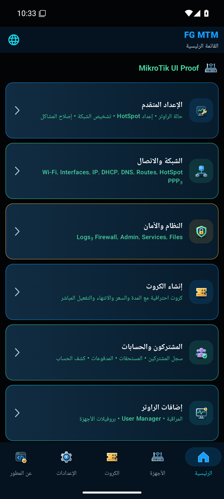
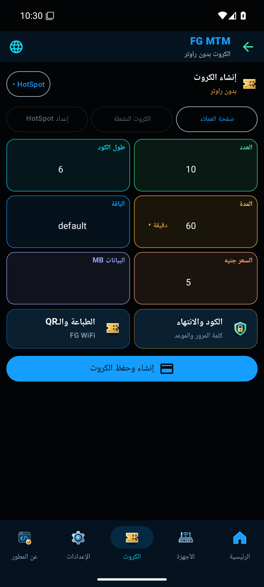
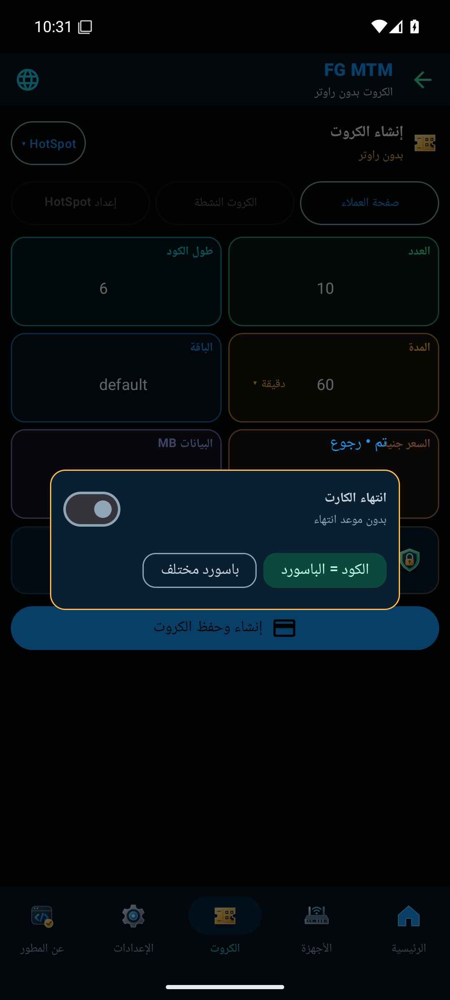
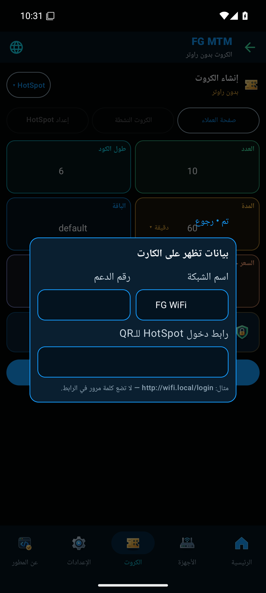

# Android 0.20.8 — تحديث FG MTM

[تحميل FG-MTM-Android-0.20.8.apk](https://github.com/FGMachines/FG-MTM/releases/download/android-v0.20.8/FG-MTM-Android-0.20.8.apk)

ثبّت التحديث فوق 0.20.7 دون حذف التطبيق. يحتفظ بهوية التثبيت وشهادة التوقيع الأصلية.

## الجديد

- إصلاح قراءة نقاط الوصول وتحديثها في العرض الواسع.
- حساب تأكيد إنشاء الكارت المختار في نص المشاركة من نتيجته الفردية؛ نجاح جزء من الدفعة لا يجعل الكروت الناجحة تظهر كغير مؤكدة.
- استمرار تحسينات تصميم 0.20.4 المستعادة في 0.20.7: قطع الاتصال في الإعدادات فقط، ست بطاقات مصغرة، قوائم النوع والمدة والباقات، ونوافذ الانتهاء وكلمة المرور والطباعة وQR وروابط المطور والإحصاءات.
- استمرار R8 وتقليص الموارد وتعطيل Debug.

## التحقق الفعلي

| الفحص | النتيجة |
|---|---|
| اختبارات الوحدة | 169 ناجحًا؛ صفر فشل |
| Lint | صفر أخطاء و19 تحذيرًا |
| اختبارات Android المختارة | 10 ناجحة على محاكي Android 15 |
| الكود المحمي | إعادة تسمية 847 فئة بالتطبيق |
| التوقيع | تحقق تشفيري ناجح لنطاق API 26–35؛ شهادة مطابقة للإصدار السابق |
| التحديث | تثبيت 0.20.8 فوق APK الرسمي 0.20.7 دون حذف التطبيق؛ بقاء الجهاز المحفوظ |
| الملف النهائي الموقّع | نجاح تشغيل الكروت المصغرة ونوافذ الانتهاء والطباعة وQR، وتوليد دفعة دون راوتر، والتنقل وUser Manager عبر واجهة محاكية للقراءة |
| الجهاز والراوتر والطابعة الفعليون | لم يُنفذ هذا الاختبار في هذه الجولة |

اختبار الحفظ غطّى بروفايل جهاز اختبار محفوظًا قبل التحديث. اختبارات أوامر إنشاء الكروت استخدمت نقلًا محاكيًا، وواجهة الراوتر في اختبار APK النهائي استخدمت API محليًا للقراءة فقط. لا يُعد ذلك إثباتًا لمصادقة عميل HotSpot أو PPPoE أو RADIUS، أو للطباعة على طابعة فعلية. المقارنة البصرية الشاملة لكل شاشة ومسار مع المرجع ما زالت ضمن المتبقي.

## صور APK النهائي

| الاتصال | الرئيسية | الكروت |
|:---:|:---:|:---:|
|  |  |  |

| الانتهاء | الطباعة وQR |
|:---:|:---:|
|  |  |

الصور من محاكي Android 15. بيانات الراوتر المعروضة بيانات اختبار محلية.

## بيانات الإصدار

- هوية التثبيت: `com.fgmachines.mikrotikmanager.preview`.
- versionCode: **38**؛ versionName: `0.20.8-review`. قد يظهر الاسم FG MTM Review.
- الحجم: **4,026,427 بايت**.
- SHA256: `9005d6b2b70b86b6f327f66bcdbc246f4aa47aeba19442c0cd64b38b986c3abd`.
- شهادة التوقيع SHA256: `4218f40caf43573a4ef9f79279e43f5a54424cdf28436e45ee3a1e84645fc502`.
- commit المصدر: `9c53ca2d7394d256a04ccdeb5bd755452822b5c3`.
- فحص البناء: `38548002045`؛ فحص مسارات Android: `38548001980`؛ فحص التحديث النهائي الموقّع: `38549455341`.

[بصمة التنزيل](https://github.com/FGMachines/FG-MTM/releases/download/android-v0.20.8/SHA256SUMS.txt)
