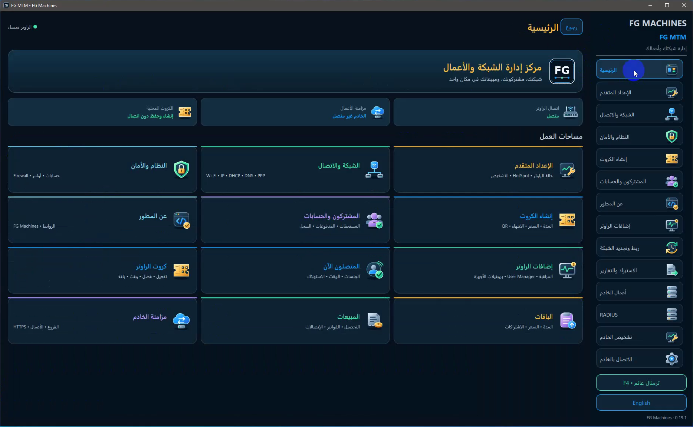
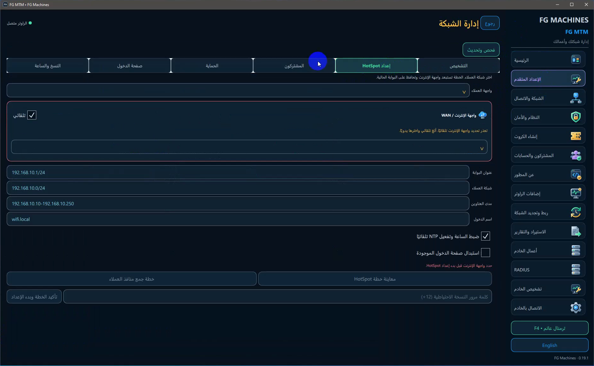
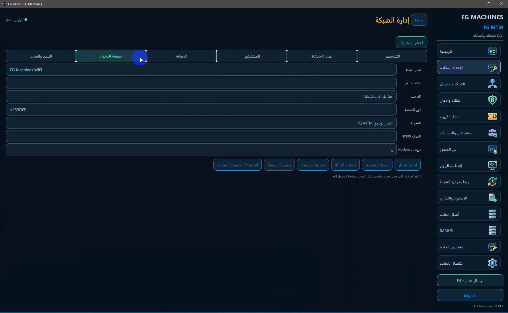
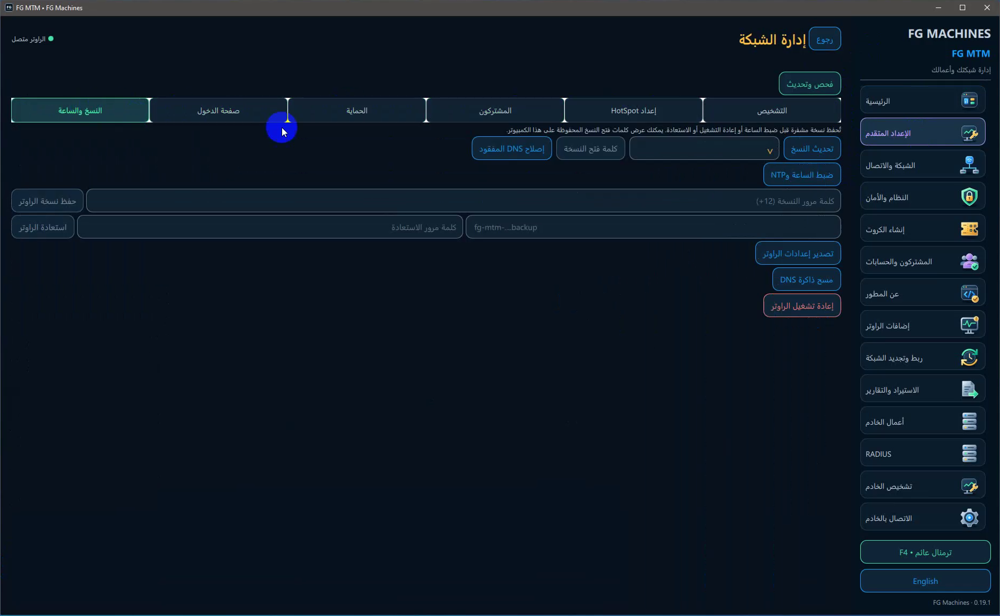
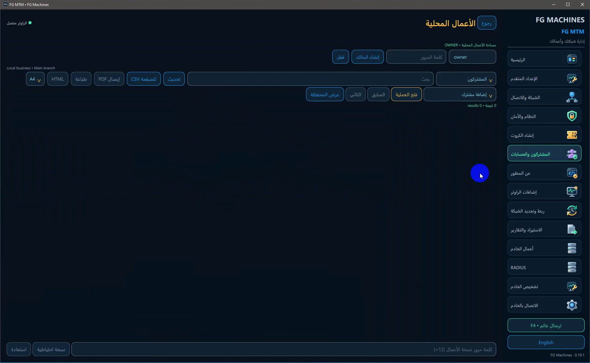
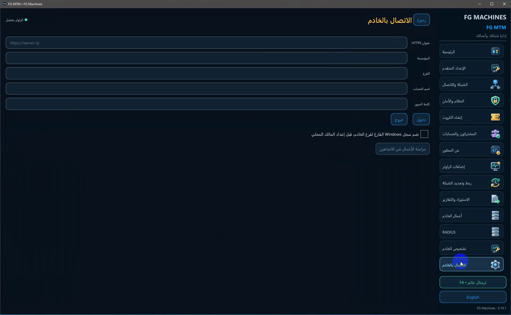
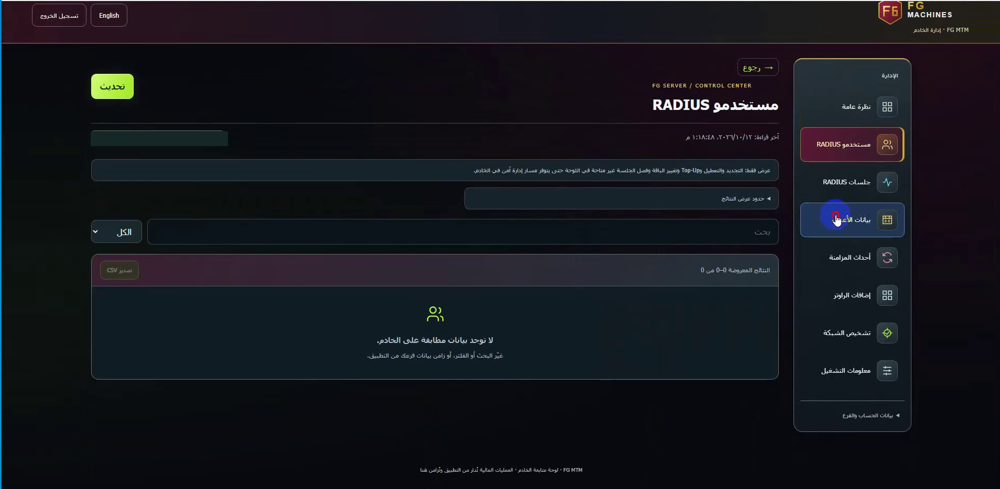
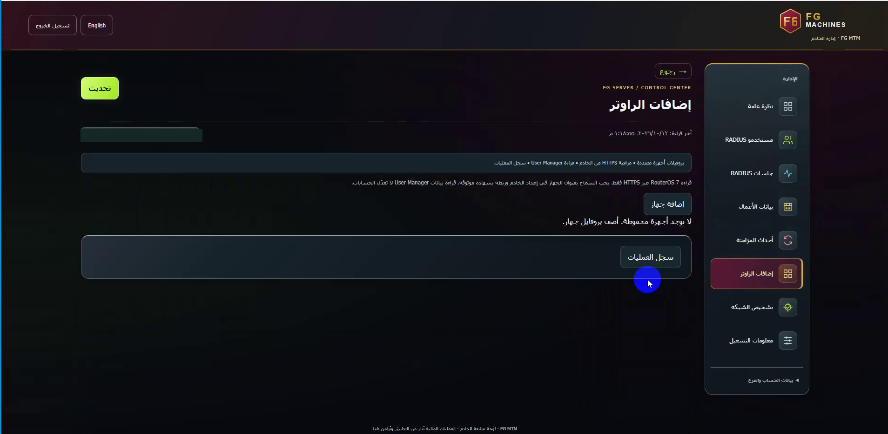
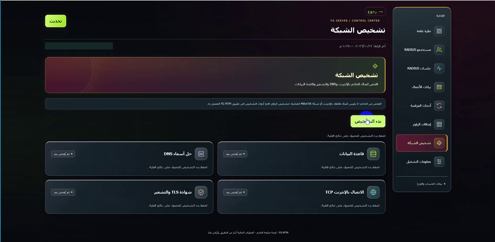
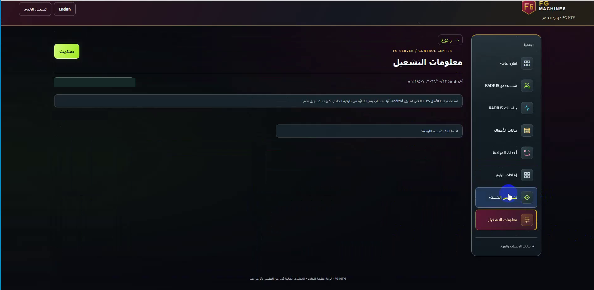

# دليل FG MTM المصوّر

دليل عملي لنسخة **Windows 0.19.1** ولوحة الخادم. هنمشي من أول اتصال بالراوتر لحد متابعة البيانات والمزامنة، بلغة واضحة وخطوات تقدر تنفذها بنفسك.

الصور من تشغيل فعلي، بعد قص الأجزاء المحيطة وإخفاء البيانات الخاصة. القيم اللي فيها أمثلة من وقت التصوير؛ **ما تنسخهاش على إنها إعدادات شبكتك**.

## قبل ما تبدأ: ثلاثة حسابات مختلفة

| الحساب | تستخدمه في إيه؟ |
| --- | --- |
| حساب MikroTik | الدخول للراوتر وإدارة الشبكة |
| المالك المحلي | حماية مساحة الأعمال على الكمبيوتر |
| حساب الخادم | الدخول والمزامنة داخل المؤسسة والفرع |

خلي كل حساب في مكانه. تغيير كلمة مرور الراوتر مش بيصلح تسجيل دخول الخادم، وتسجيل دفعة في الأعمال مش معناه لوحده إن الإنترنت اتفتح للعميل.

## أولًا: Windows خطوة بخطوة

### 1. اتصل بالراوتر الأول

افتح **الشبكة والاتصال** ثم مساحة اتصال الراوتر. اختار الجهاز من نتائج الاكتشاف، أو اكتب عنوانه واسم المستخدم وكلمة المرور والبروتوكول والمنفذ المناسبين لإعداداته.

لازم الكمبيوتر يقدر يوصل للراوتر عبر الشبكة أو مسار خاص جاهز. مش شرط كابل مباشر بين الكمبيوتر وMikroTik طول الوقت؛ المهم وجود طريق اتصال يسمح بالإدارة.

بعد الدخول، ارجع **الرئيسية** وراجع حالتين منفصلتين: الراوتر والخادم. ممكن الراوتر يكون متصل والخادم لسه غير متصل، زي الصورة.

**لو الاتصال ما نجحش:** راجع العنوان، وبعده بيانات حساب الراوتر، وبعدين الخدمة والمنفذ والصلاحيات. ولو الاكتشاف ما طلعش الجهاز، جرب العنوان يدويًا قبل ما تعتبره عطلًا.

### 2. افحص الشبكة قبل إعداد HotSpot

من **الإعداد المتقدم** افتح التشخيص واقرأ النتائج. بعد كده افتح **إعداد HotSpot**:

1. حدد واجهة العملاء اللي هتوزع الخدمة عليهم.
2. راجع واجهة الإنترنت **WAN**. لو البرنامج ما قدرش يحددها، اختارها يدويًا بناءً على التوصيلات.
3. أدخل عنوان البوابة وشبكة العملاء ومدى العناوين واسم الدخول بما يناسب شبكتك.
4. افتح **معاينة خطة HotSpot**، وراجع اللي هيتغير.
5. أدخل كلمة مرور النسخة الاحتياطية لما يطلبها البرنامج، ثم أكد الخطة بعد المراجعة.
6. اقرأ نتيجة التنفيذ، وجرب جهاز عميل وكارت اختبار قبل تشغيل دفعة للعملاء.

**خد بالك:** ما تستخدمش عناوين المثال من غير مراجعة، وما تدخلش واجهة الإنترنت ضمن منافذ العملاء. رسالة تعذر تحديد WAN معناها خطوة محتاجة اختيار، مش نجاح الإعداد.

### 3. ظبط صفحة دخول العملاء

من **الإعداد المتقدم ← صفحة الدخول** تقدر تعدل اسم الشبكة وهاتف الدعم والترحيب والألوان والشروط والموقع، وتختار الشعار وبروفايل HotSpot.

ابدأ بحفظ التصميم، وبعده **معاينة الصفحة**. راجع **معاينة الحالة** قبل تثبيت الصفحة على الراوتر. الشاشة تتيح أيضًا استعادة الصفحة السابقة.

**بالمصري:** الصفحة ممكن تبقى شكلها ممتاز في المحرر، لكن العميل لسه بيشوف القديمة. حفظ التصميم مش هو تثبيته. كمل خطوة التثبيت، واقرأ النتيجة، وجرب من جهاز عميل بمتصفح جديد.

هاتف الدعم اللي ظهر في التسجيل اتخفى من الصورة المنشورة. استخدم رقم الدعم اللي إنت عايز تنشره لعملائك، مش رقم مأخوذ من شرح.

### 4. خد نسخة قبل التغيير

من **النسخ والساعة** هتلاقي حفظ نسخة الراوتر واستعادتها، وتصدير الإعدادات وضبط الساعة وNTP وبعض أدوات DNS.

خد نسخة احتياطية قبل أي تغيير مهم، واحفظ كلمة مرورها في مكان آمن. قبل الاستعادة راجع الجهاز والملف المقصودين، واختار وقت مناسب لأن الاستعادة أو إعادة التشغيل ممكن يوقفوا الخدمة.

لو هتستخدم انتهاء كروت بتاريخ ووقت، راجع ساعة الراوتر والمنطقة الزمنية؛ التاريخ المكتوب على الكارت مش كفاية لو ساعة النظام غلط.

### 5. افتح المشتركين والأعمال المحلية

من **المشتركون والحسابات** ادخل **الأعمال المحلية**. جهز حساب المالك المحلي لو البرنامج طلبه، وبعده اختار نوع البيانات من القائمة: مشتركين أو باقات أو فواتير، حسب المهمة.

الشاشة تتيح البحث والتحديث وفتح سجل المشترك والمحفظة، ومعها التصدير والطباعة والنسخ الاحتياطي. راجع الفرع الحالي قبل تسجيل عملية.

**افصل بين الحساب والخدمة:** الفاتورة بتسجل مستحقات، والدفعة بتسجل تحصيل. تعديل سجل مالي لا يثبت وحده أن حساب الإنترنت اتجدد أو اتفعل؛ راجع الربط وخطوة التطبيق على الراوتر والنتيجة.

ظهور **0 نتيجة** يعني إن العرض الحالي مفيهوش سجلات مطابقة. ممكن القائمة فاضية أو التصفية مختلفة. والبيانات المحلية مش بتروح للخادم لمجرد فتح الصفحة؛ لازم اتصال ومزامنة.

### 6. اربط Windows بالخادم لما تحتاج

افتح **الاتصال بالخادم** واكتب بيانات حسابك:

| الحقل | تكتب إيه؟ |
| --- | --- |
| عنوان HTTPS | أصل عنوان خادمك، مثل `https://server.example`، حسب إعداد مشغّل الخدمة |
| المؤسسة | معرّف المؤسسة المرتبط بحسابك |
| الفرع | معرّف الفرع المرتبط بالحساب نفسه |
| اسم الحساب | مستخدم الخادم، مش اسم حساب MikroTik |
| كلمة المرور | كلمة مرور حساب الخادم |

اضغط **دخول** وانتظر نتيجة مؤكدة. بعد الدخول الصحيح ومراجعة الفرع، استخدم **مزامنة الأعمال في الاتجاهين**، واقرأ النتيجة بدل الاعتماد على ظهور الزر.

خيار **ضم سجل Windows الفارغ لفرع الخادم** مخصص لسجل محلي فارغ، قبل إعداد المالك المحلي. **مش أداة لدمج سجل ممتلئ عشوائيًا.**

في التثبيت الجديد الموثق، حقول الاتصال تبدأ فارغة. كل مستخدم يدخل بياناته؛ المؤسسة والفرع مش قيم ثابتة لكل الناس. تحديث تثبيت قائم قد يحتفظ بالإعدادات القديمة، فراجعها بنفسك.

## ثانيًا: لوحة الخادم

### 1. الدخول والنظرة العامة

افتح عنوان اللوحة اللي مشغّل الخدمة أعطاه لك، وسجل دخولك بحسابك. أول حساب يجهزه مشغّل الخادم؛ النسخة المصوّرة لا تعرض تسجيلًا عامًا للحسابات.

**نظرة عامة** تجمع مؤشرات مستخدمي RADIUS وبيانات الأعمال والمزامنة. اضغط **تحديث** لقراءة أحدث، وبعده افتح القسم المطلوب من القائمة الجانبية.

بص للمؤسسة والفرع والصلاحية في بيانات الحساب. دي نطاق حسابك، مش بيانات افتراضية لكل مستخدم. والأرقام في الصور تخص جلسة التصوير، مش عدد عملاء لازم يظهر عندك.

### 2. مستخدمو RADIUS والجلسات

قسم **مستخدمو RADIUS** يعرض البيانات والبحث والتصفية والتصدير لما تتوفر نتائج وصلاحية مناسبة. **جلسات RADIUS** تعرض سجلات الجلسات اللي وصلت للخادم.

الشاشة المصوّرة توضح أن التجديد وتغيير الباقة وعمليات الحسابات ليست متاحة من هذا العرض. ما تفترضش إن كل إدارة الراوتر موجودة في لوحة الخادم.

**لو القائمة فاضية:** راجع نطاق الحساب والفرع والتصفية، وبعدين إعداد الخدمة ووصول البيانات. لو القراءة غير متاحة، ما تعتبرهاش صفر استخدام أو صفر حسابات.

### 3. بيانات الأعمال وأحداث المزامنة

من **بيانات الأعمال** راجع السجلات المتاحة لحسابك. ومن **أحداث المزامنة** تابع اللي وصل من الأجهزة وحالة معالجته.

لو عملت بيانات على Windows ومظهرتش:

1. اتأكد إنك دخلت على الخادم بنجاح.
2. راجع المؤسسة والفرع والصلاحيات.
3. نفذ المزامنة من التطبيق، واقرأ نتيجتها.
4. حدث عرض اللوحة، وراجع أحداث المزامنة ووقتها.

ما تغيرش معرّف المؤسسة أو الفرع عشوائيًا علشان تظهر بيانات تانية. كل نطاق لازم يطابق الحساب المصرح له.

### 4. إضافات الراوتر

الحساب المخوّل يقدر يضيف بروفايل جهاز ويراجع سجل العمليات. القراءة الموثقة في هذا القسم تستخدم **RouterOS 7 عبر HTTPS**، وتشمل بيانات المراقبة وUser Manager المتاحة. عرض User Manager هنا للقراءة؛ لا يغير حسابات الراوتر.

قبل إضافة الجهاز، اتأكد إن:

- الخادم يقدر يوصل للراوتر.
- إعداد الخدمة يسمح بالعنوان والمنفذ.
- شهادة HTTPS موثوقة حسب إعداد الخادم.
- حساب الراوتر له صلاحية القراءة المطلوبة.

**بالمصري:** حفظ البروفايل مش بيعمل طريق اتصال. لو الراوتر داخل شبكة خاصة، لازم الطريق يبقى جاهز الأول. وبعد الحفظ اطلب القراءة وراجع النتيجة والسجل.

الصورة تعرض الحالة قبل إضافة البروفايلات، علشان كده مفيش أجهزة محفوظة فيها.

### 5. تشخيص الخادم

افتح **تشخيص الشبكة** واضغط **بدء التشخيص**. الفحوص الموثقة تشمل قاعدة البيانات وDNS واتصال الإنترنت عبر TCP وشهادة TLS والتشفير.

**لم يُفحص بعد** معناها الاختبار ما اتنفذش في اللحظة دي؛ مش نجاح ومش فشل. اقرأ نتيجة كل فحص ووقته.

ده تشخيص للخادم. علشان تفحص شبكة MikroTik المحلية أو دخول عميل HotSpot، استخدم أدوات التطبيق المتصل بالراوتر واختبار جهاز عميل.

### 6. معلومات التشغيل والحساب

**معلومات التشغيل** توضح معلومات الربط وحدود عمل اللوحة. و**بيانات الحساب والفرع** تعرض نطاق الحساب بعد الدخول.

عنوان الخادم ومعرّف الفرع اتخفوا من الصور المنشورة. استخدم بياناتك الخاصة، وما تحطش كلمات مرور أو مفاتيح خاصة في صور الدعم.

### 7. للمشغّل: التحديث والصيانة

قبل تحديث خادم قائم، خد نسخة من قاعدة البيانات والإعدادات والشهادات، وسجل الإصدار ومسار التثبيت. استخدم حزمة الإصدار الصحيحة ومصدر FG Machines المعتمد.

بعد التحديث، راجع حالة الخدمات والسجلات ونجاح الترحيل، وجرب دخول حساب موجود والمزامنة والوظيفة الجديدة. **ظهور الخدمة Started لوحده مش إثبات إن التحديث اكتمل وظيفيًا.**

لو ظهر خطأ صلاحيات، حدد هل المشكلة في تشغيل Docker أو في الملفات داخل الحاوية. ما تحذفش وحدات التخزين أو قاعدة البيانات كحل سريع. التحديث يحافظ على بيانات المستخدمين، ولا يزرع بيانات مؤسسة شخص آخر.

الأوامر التشغيلية تبقى بالإنجليزية كما هي علشان النسخ والتنفيذ الصحيح؛ الشرح المحيط بها هو اللي بالمصري.

## أسئلة شائعة وحل المشكلات

| السؤال | الإجابة |
| --- | --- |
| لازم MikroTik يتوصل بالكمبيوتر مباشرة طول الوقت؟ | لا؛ لازم مسار شبكة يسمح بالوصول. الراوتر يكمل الخدمة بعد إغلاق البرنامج حسب إعداداته. |
| الراوتر متصل والخادم مش متصل، ليه؟ | كل واحد له حساب وإعداد مستقل؛ راجع الاتصال بالخادم لوحده. |
| ليه بياناتي مش ظاهرة في اللوحة؟ | راجع النطاق والصلاحيات والتصفية، ثم اتصال الخادم والمزامنة ونتيجتها. |
| HotSpot وUser Manager وRADIUS نفس الحسابات؟ | مش بالضرورة؛ ممكن الحسابات محفوظة في مصادر مختلفة. اختار النظام اللي شبكتك بتستخدمه. |
| المؤسسة والفرع بيتغيروا لكل مستخدم؟ | القيم مرتبطة بحساب المستخدم؛ في تثبيت Windows الجديد تبدأ الحقول فارغة. |
| حفظ التصميم يعني صفحة الدخول اتنشرت؟ | لا؛ لازم تثبيت على الراوتر ونتيجة مؤكدة وتجربة من جهاز عميل. |
| تسجيل دفع يفتح الإنترنت؟ | مش بالضرورة؛ السجل المالي يختلف عن تفعيل حساب الشبكة. راجع الربط والتنفيذ. |
| ظهر خطأ بعد تنفيذ عملية، أكررها؟ | حدث الحالة الأول؛ ممكن العملية وصلت والرد اتقطع. راجع قبل التكرار. |
| قائمة الحسابات فاضية، يبقى كلها اتحذفت؟ | لا؛ راجع التصفية والنطاق وحالة القراءة. البيانات غير المعروفة مش صفر. |
| أبعث إيه للدعم؟ | نسخة البرنامج، موديل الراوتر وإصداره، اسم الشاشة ورسالة الخطأ والخطوة السابقة، مع إخفاء البيانات الخاصة. |

## التواصل مع FG Machines

- [الموقع الرسمي — fgmachines.org](https://fgmachines.org) — **الموقع قيد الإنشاء**.
- [الحساب الشخصي على Facebook](https://www.facebook.com/share/1EKVAyZZ2C/).
- [صفحة FG Machines التجارية](https://www.facebook.com/share/1T7r3WpH8Y/).
- [جروب Facebook — المناقشات والدعم ومشاركة التجارب](https://www.facebook.com/share/g/1Eo3dADWFs/).

[العودة إلى الصفحة الرئيسية](../README.md)
